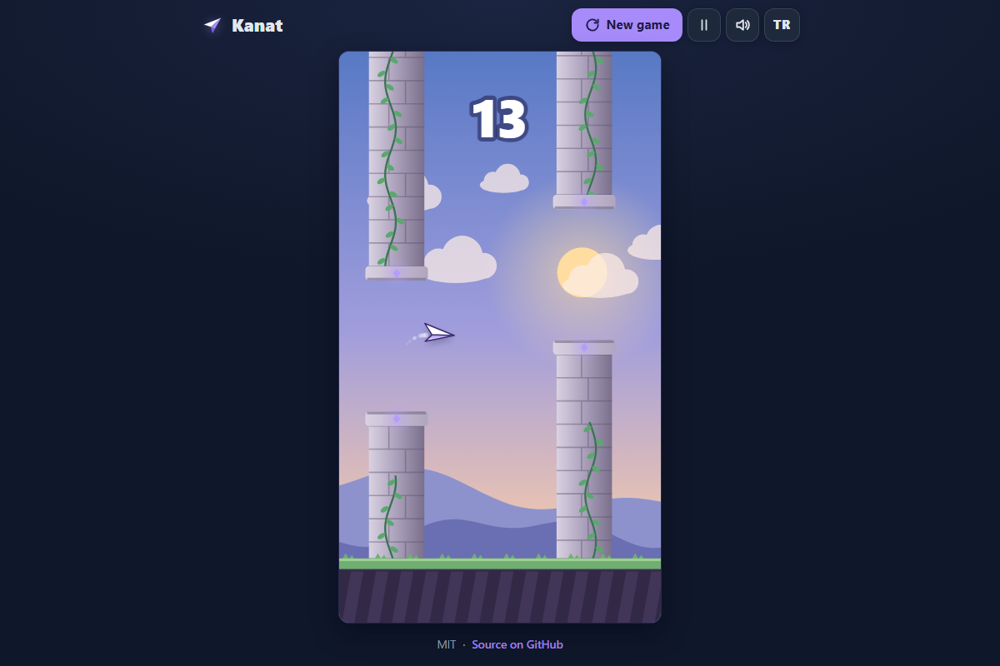

# Kanat - a one-tap paper plane flight through stone gates, from day into dusk

[](https://github.com/celaldrg/kanat/actions/workflows/test.yml)
[](LICENSE)

**▶ Play now: https://celaldrg.github.io/kanat/**



*Kanat* is Turkish for "wing". Tap to lift a small paper plane, glide through the gaps between vine-covered stone columns, and watch the sky slide from morning blue into a starry violet dusk as your score climbs.

## Features

- One-tap controls on phones, tablets and desktops (touch, mouse or keyboard).
- Original art drawn with canvas shapes: a paper plane, stone columns with vines and glowing gems, parallax hills and clouds.
- The sky shifts from day to dusk as the score rises; the course gets slightly faster and the gaps slightly narrower (both capped).
- Bronze (10), silver (25) and gold (50) medals, and a best score saved in your browser.
- Fixed-timestep physics: the game plays the same at 30, 60 or 144 fps.
- English and Turkish interface, saved between visits.
- Pause with P or Esc; the game also pauses when you switch tabs.
- Small sound effects made with WebAudio, with a mute button.
- Crisp on high-DPI screens; honours `prefers-reduced-motion`.
- No dependencies, no build step, no tracking: plain HTML, CSS and JavaScript modules.

## How to play

| Action | Keyboard | Touch / mouse |
| --- | --- | --- |
| Start and flap | Space, ↑ or W | Tap or click the play area |
| Pause / resume | P or Esc | Pause button in the header |
| Play again after a crash | Space | Tap the play area or "Play again" |
| New game | - | "New game" button |
| Sound on / off | - | Speaker button |
| Language | - | TR / EN button |

Pass through a gate to score a point. Touching a column, the ground or the top of the sky ends the round.

## Run locally

Any static file server works. ES modules need `http://`; opening `index.html` as a `file://` URL will not work.

```sh
npx serve .
# or
python3 -m http.server 8000
```

Then open the printed address (for example http://localhost:3000). Add `?demo` to the URL to open the preset mid-game scene used for the screenshot.

## Tests

```sh
node --test
```

The suite uses only `node:test` and `node:assert/strict` (Node 22 in CI) and runs in about a second. It covers:

- circle-vs-rectangle collision: overlap, exactly touching, clear miss, and corner cases;
- game over on hitting the ground, the ceiling or a column;
- scoring exactly once per gate passed, gate spacing, gap limits and the difficulty caps;
- the same result at different frame rates, long frames and pause;
- determinism: the same seed gives the same game;
- high score saved to and read back from a fake `localStorage`, and the storage helper not throwing when `localStorage` throws;
- the demo scene and its autopilot;
- UI logic: overlays, what a tap means in each phase, key mapping, canvas sizing, colour blending, and that English and Turkish have the same strings.

## Project structure

```
index.html            page, overlays and header
style.css             dark theme and responsive layout
src/
  engine.js           game state, physics, gates, scoring (pure)
  collision.js        circle-vs-rectangle tests (pure)
  config.js           tuning and difficulty curve (pure)
  rng.js              seeded random numbers (pure)
  score.js            best score and medals (pure)
  storage.js          try/catch wrapper around localStorage
  demo.js             ?demo scene and autopilot (pure)
  i18n.js             English and Turkish strings (pure)
  view.js, controls.js, viewport.js, palette.js   small pure UI helpers
  render.js           canvas drawing
  ui.js, input.js, audio.js, main.js              DOM, input, sound, game loop
test/                 node:test suites
docs/screenshot.png   README image
```

## License

[MIT](LICENSE) © 2026 Celalettin Durgaç

---

## Türkçe

**Kanat** - tek dokunuşla, gündüzden alacakaranlığa taş kapılar arasında kağıt uçak uçuşu.

**▶ Hemen oyna: https://celaldrg.github.io/kanat/**

Dokun, küçük kağıt uçak yükselsin; sarmaşıklı taş sütunların arasındaki boşluklardan süzül. Skorun arttıkça gökyüzü sabah mavisinden yıldızlı mor bir alacakaranlığa döner.

### Özellikler

- Telefon, tablet ve bilgisayarda tek dokunuşla oynanır (dokunma, fare ya da klavye).
- Canvas şekilleriyle çizilmiş özgün grafikler: kağıt uçak, sarmaşıklı ve parlayan taşlı sütunlar, paralaks tepeler ve bulutlar.
- Skor yükseldikçe gökyüzü gündüzden alacakaranlığa geçer; parkur biraz hızlanır, boşluklar biraz daralır (ikisinin de sınırı var).
- Bronz (10), gümüş (25) ve altın (50) madalya; en iyi skor tarayıcında saklanır.
- Sabit adımlı fizik: oyun 30, 60 ya da 144 fps'te aynı oynanır.
- İngilizce ve Türkçe arayüz; seçim bir sonraki ziyarette hatırlanır.
- P ya da Esc ile duraklat; sekme değiştirince oyun kendiliğinden durur.
- WebAudio ile küçük ses efektleri ve sessize alma düğmesi.
- Yüksek çözünürlüklü ekranlarda net görüntü; `prefers-reduced-motion` ayarına uyar.
- Bağımlılık, derleme adımı ve izleme yok: yalın HTML, CSS ve JavaScript modülleri.

### Nasıl oynanır

| Eylem | Klavye | Dokunma / fare |
| --- | --- | --- |
| Başla ve kanat çırp | Boşluk, ↑ ya da W | Oyun alanına dokun ya da tıkla |
| Duraklat / devam et | P ya da Esc | Üst çubuktaki duraklat düğmesi |
| Düştükten sonra tekrar oyna | Boşluk | Oyun alanına dokun ya da "Tekrar oyna" |
| Yeni oyun | - | "Yeni oyun" düğmesi |
| Ses aç / kapat | - | Hoparlör düğmesi |
| Dil | - | TR / EN düğmesi |

Her kapıdan geçince bir puan alırsın. Bir sütuna, yere ya da gökyüzünün tepesine değersen tur biter.

### Yerelde çalıştırma

Herhangi bir statik dosya sunucusu yeterli. ES modülleri `http://` ister; `index.html` dosyasını `file://` adresiyle açmak çalışmaz.

```sh
npx serve .
# ya da
python3 -m http.server 8000
```

Sonra yazılan adresi aç (örneğin http://localhost:3000). Ekran görüntüsündeki hazır oyun ortası sahnesi için adrese `?demo` ekle.

### Testler

```sh
node --test
```

Testler yalnızca `node:test` ve `node:assert/strict` kullanır (CI'da Node 22) ve yaklaşık bir saniyede biter. Kapsadıkları: daire-dikdörtgen çarpışması (üst üste binme, tam temas, açık ıska, köşe durumları); yere, tavana ya da sütuna çarpınca oyunun bitmesi; geçilen her kapı için tam bir puan, kapı aralığı, boşluk sınırları ve zorluk sınırları; farklı kare hızlarında aynı sonuç, uzun kareler ve duraklatma; aynı tohumla aynı oyun; en iyi skorun sahte bir `localStorage`'a yazılıp geri okunması ve `localStorage` hata fırlattığında depolama yardımcısının çökmemesi; demo sahnesi ve otomatik pilotu; arayüz mantığı (katmanlar, her aşamada dokunmanın anlamı, tuş eşleme, canvas boyutu, renk geçişi, İngilizce ve Türkçe metinlerin eşleşmesi).

### Lisans

[MIT](LICENSE) © 2026 Celalettin Durgaç
